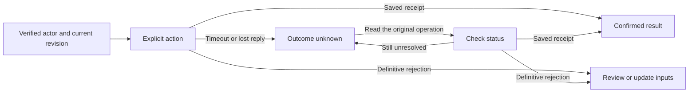

# Web workflow state inventory

Reviewed on 2026-11-20 against the Next.js pages and route handlers in
`apps/web/app`, the route registrations in `services/api/src/app.ts`, and the
allowlisted roles in `workers/run.mjs`. The tables map product workflows whose
state affects a user action, data ownership or a retry. Multiple machines can
govern one screen. Identity, authorization, revision, request receipts, expiry,
leases and provider dispatch can all affect which transitions are valid. Hosted
verification is linked where available.
Mobile and Stripe activation are deferred by the product owner.

## Design decision

Keep each durable workflow in its owning database or service. Use the existing
route and component patterns to model the browser states at that boundary. Make
transitions explicit where actions need a guard, a durable result, or recovery
after a lost reply. Use local tagged states when a screen must distinguish
loading, a verified result, and denied or unavailable access. A menu that only
opens and closes can use a boolean.

- **UX** Show whether the result is confirmed, rejected, stale or still unknown.
  For an unknown outcome, offer a status check. Show an empty result only after
  a successful read for the current account and resource.
- **DX** Preserve existing API and database contracts. Bind writes to the actor,
  resource and revision that authorized them. Add durable request identity for
  writes that can be duplicated or reversed by a retry.
- **AX** Put the transition owner, read-only recovery path and exact regression
  tests beside each workflow. Record which checks used fixtures, native services,
  or the hosted environment so agents can act on the right evidence.

`npm run test:web` checks that each web entry point, registered API module and
worker role has an inventory entry and that the source anchors still exist.
The check catches navigation drift. Behavioral tests establish transitions.
See `apps/web/tests/workflow-inventory.test.ts`.

A confirmed result and a failed follow-up refresh can coexist. An actor or
resource change invalidates the view, including any late response for the
previous scope. A read can establish the current saved state. A receipt bound
to the original operation establishes which write produced it. An empty read
can leave an earlier write unresolved.

## Web entry points

| Surface | Pages and route handlers |
| --- | --- |
| Landing, account and entry | `apps/web/app/page.tsx`, `apps/web/app/data-and-privacy/page.tsx`, `apps/web/app/login/page.tsx`, `apps/web/app/signup/page.tsx`, `apps/web/app/forgot-password/page.tsx`, `apps/web/app/settings/password/page.tsx`, `apps/web/app/settings/data-rights/page.tsx`, `apps/web/app/auth/callback/route.ts`, `apps/web/app/api/auth/[action]/route.ts`, `apps/web/app/api/auth/session/route.ts` |
| Author workspace | `apps/web/app/dashboard/page.tsx`, `apps/web/app/assets/page.tsx`, `apps/web/app/books/new/page.tsx`, `apps/web/app/books/[bookId]/page.tsx`, `apps/web/app/books/[bookId]/overview/page.tsx`, `apps/web/app/books/[bookId]/memory/page.tsx`, `apps/web/app/books/[bookId]/plan/page.tsx`, `apps/web/app/books/[bookId]/ai/page.tsx`, `apps/web/app/settings/ai/page.tsx` |
| Production and sales | `apps/web/app/books/[bookId]/publish/page.tsx`, `apps/web/app/books/[bookId]/translate/page.tsx`, `apps/web/app/analytics/page.tsx`, `apps/web/app/billing/page.tsx`, `apps/web/app/api/private-audio/[actor]/segments/[projectId]/[index]/route.ts` |
| Collaboration and operations | `apps/web/app/team/page.tsx`, `apps/web/app/team/accept/page.tsx`, `apps/web/app/tasks/page.tsx`, `apps/web/app/approvals/page.tsx`, `apps/web/app/community/page.tsx`, `apps/web/app/community/[id]/page.tsx`, `apps/web/app/referrals/page.tsx`, `apps/web/app/admin/page.tsx`, `apps/web/app/api/backend/[...path]/route.ts` |

## Browser and API boundary machines

| Workflow | State and transitions to examine | Source anchors |
| --- | --- | --- |
| Public and shell navigation | Responsive menu closed or open. Selection, dismissal and Escape close it. The author shell also changes its displayed links and pending navigation when the session or workspace changes. | `apps/web/components/Header.tsx`, `apps/web/components/AuthorShell.tsx` |
| Sign-in, signup and account changes | Session unverified, verified actor, signed out or changed. Signup can await email confirmation. Callback success or error and an in-flight action each belong to their original account context. Form fields stay fixed while an authentication request is pending and become editable again after its response. A malformed authentication reply shows a retryable error rather than confirming success or navigating. A failed email-link callback opens sign-in with an accessible recovery message. | `apps/web/components/AuthCard.tsx`, `apps/web/lib/browser-session.ts`, `apps/web/app/auth/callback/route.ts`, `apps/web/app/api/backend/[...path]/route.ts` |
| Password recovery | Reset requested, email link exchanged or invalid, session verified, update pending or completed. Sending a link and changing the password are separate actions. | `apps/web/app/forgot-password/page.tsx`, `apps/web/app/settings/password/page.tsx`, `apps/web/app/api/auth/[action]/route.ts`, `apps/web/tests/auth.test.ts` |
| Workspace selection and navigation | Profile provisioned by auth, then workspace selection, loading, verified, stale or unavailable. Changing actor or workspace invalidates dependent screens. The current authorized list controls selection and validates the remembered workspace. | `apps/web/components/AuthorDashboard.tsx`, `apps/web/components/AuthorShell.tsx`, `apps/web/lib/workspace-selection.ts`, `tests/e2e/workspace-selection-browser.mjs` |
| Workspace creation and recovery | The verified account submits an operation ID saved in the tab before dispatch. The database atomically creates the workspace, organization, both owner memberships and an actor-bound receipt. Exact retries return the same workspace; changed details conflict. A lost reply survives reload, including an unavailable workspace or dashboard read. Checking reads the original receipt; an absent receipt stays unconfirmed. Closing waits for an in-flight create or fences a delayed one, and a committed create remains confirmed. The old creation endpoint remains available for older clients. | `apps/web/components/AuthorDashboard.tsx`, `apps/web/lib/workspace-creation-recovery.ts`, `services/api/src/routes/workspaces.ts`, `supabase/migrations/20261120024556_workspace_creation_receipts.sql`, `tests/security/workspace-creation-receipts.test.sql`, `tests/security/native-workspace-creation-receipts.mjs`, `apps/web/tests/session-safety-mounted.mjs`, `tests/e2e/workspace-creation-recovery-browser.mjs` |
| Dashboard and book overview | Snapshot loading, verified for this viewer, failed or invalidated on navigation or account change. The dashboard shows library actions after verifying the workspace. The workspace and per-book views summarize distinct authoritative jobs, document versions and exports. | `services/api/src/routes/dashboard.ts`, `services/api/src/routes/book-overview.ts`, `apps/web/components/AuthorDashboard.tsx`, `apps/web/components/BookOverview.tsx`, `apps/web/tests/session-safety-mounted.mjs`, `apps/web/tests/book-overview-mounted.mjs` |
| Book creation and settings | A new book starts as a draft. Setup can recover an exact creation request by the original book ID, actor, workspace and details. Different inputs for the same ID conflict. Book edits save against the observed update timestamp or conflict. | `services/api/src/routes/books.ts`, `apps/web/lib/manuscript-setup.ts`, `services/api/src/book-creation.test.ts`, `tests/e2e/book-creation-recovery-browser.mjs` |
| Workspace folders | Folders can be created, renamed or moved within their workspace. A move checks the parent chain. Template seeding checks the saved folders and creates missing entries. An interrupted seed can leave some folders saved. | `services/api/src/routes/folders.ts`, `apps/web/components/AssetBrowser.tsx`, `apps/web/app/assets/page.tsx`, `apps/web/tests/workspace-context-components.test.ts` |
| Book setup and manuscript intake | Book setup, upload, quarantine and import are separate. Selecting a PDF explains how the manuscript language controls OCR. After verification, PDF intake reads the text layer and uses local OCR for pages without one. The receipt identifies recovered and unresolved pages for review. Worker capacity triggers retry. A scan that yields no readable manuscript keeps its original and creates no chapters. Starter content has its own quote. The author can retry a model catalog read without recreating the book or chapter. A quote recovery key retains its original model across catalog changes, with no model substitution. | `apps/web/components/BookSetupClient.tsx`, `services/api/src/routes/assets.ts`, `services/api/src/lib/manuscript-import.ts`, `services/document/parsers/pdf_parser.py`, `scripts/test-processing-containers.py`, [local processing configuration](LOCAL_PROCESSING_RUNTIME.md) |
| Manuscript editing and recovery | Saved base, dirty draft, save pending, confirmed, conflict or unknown. A versioned JSON backup can be reviewed, reopened into the editor or used as text when its scope or base is incompatible. A recovered draft still needs a save. A dirty title disables reordering with an explanation while chapter selection remains available with confirmation. | `apps/web/tests/editor-numbering-mounted.mjs`, `apps/web/components/BookEditorClient.tsx`, `apps/web/lib/chapter-draft.ts`, `services/api/src/routes/chapters.ts`, `apps/web/tests/chapter-draft.test.ts`, `services/api/src/manual-chapter-save.test.ts` |
| Chapter creation, title and order | Creation, renaming and reordering each have their own preconditions. Creation can replay an exact request. An actor/book scoped tab pointer stores only request identity. After reload, a not-found read remains unconfirmed, while closing fences delayed creation and an existing or removed receipt stays authoritative. The retained receipt prevents recreation after deletion. Title edits pin a revision and have a receipt with separate read and close actions. Reorder compares the supplied chapter list with the authoritative book before assigning positions. | `apps/web/components/BookEditorClient.tsx`, `apps/web/components/ChapterTitleEditor.tsx`, `services/api/src/routes/books.ts`, `services/api/src/lib/chapter-title.ts`, `tests/security/chapter-creation.test.sql`, `tests/security/chapter-title.test.sql`, `apps/web/lib/chapter-creation-recovery.ts`, `tests/security/chapter-creation-recovery.test.sql`, `tests/security/native-chapter-creation-recovery.mjs` |
| Chapter version restore | Confirmation, request in flight, outcome unknown, saved and current, or saved and superseded. Check restore status reads the existing version by actor, chapter, target, expected revision and operation. An absent receipt leaves the outcome unknown. A superseded restore keeps the draft and prompts review. | `apps/web/components/BookEditorClient.tsx`, `services/api/src/routes/chapters.ts`, `services/api/src/manual-chapter-save.test.ts`, `apps/web/tests/editor-numbering-mounted.mjs`, `tests/e2e/native-author-files.mjs` |
| Manual Book Bible | Draft, saved, conflicting or unknown mutation, deleted entry and closed receipt. The unsaved-change guard releases when the view confirms a save and all drafts are clean. A status read uses the original operation identity. | `apps/web/components/BookMemoryClient.tsx`, `services/api/src/routes/book-memory.ts`, `tests/security/manual-book-bible-recovery.test.sql`, `apps/web/tests/book-memory-navigation-mounted.mjs` |
| Manual listing metadata | New listing, saved revision, an edited form, confirmed save or conflict. An empty observed revision allows insertion. An existing revision requires the observed timestamp. The resulting saved fields inform retailer preflight. | `apps/web/components/BookMemoryClient.tsx`, `services/api/src/routes/book-memory.ts`, `services/api/src/authoring-metadata.test.ts`, `apps/web/tests/metadata-draft.test.ts` |
| Book search and source reading | Search input, pending results, available or unavailable search, selected passage. Opening or reopening a result rechecks access and the exact saved version before showing its text. Closing the reader needs no request; reopening keeps the last section after verification. A Book Bible hit must still match the current saved entry before it opens. The search result follows the editor loading and recovery lock, including if the editor locks during verification. A citation mismatch clears the results and keeps unsaved edits intact. A different selection supersedes the previous read. An access denial or invalidated citation clears the saved excerpts and asks for a fresh search; a transient read failure keeps the last verified passage. | `apps/web/components/BookSearchPanel.tsx`, `apps/web/components/SearchSourcePassage.tsx`, `services/api/src/routes/book-memory.ts`, `apps/web/tests/book-search-mounted.mjs` |
| Asset library, upload and versioning | The account owns the workspace selection read. Changing the selection or using Back starts verification of that workspace and hides the earlier library. Upload goes from selected to allocated, uploaded, scanned or quarantined, and versioned. An approval belongs to the reviewed version. | `apps/web/app/assets/page.tsx`, `apps/web/components/AssetBrowser.tsx`, `services/api/src/routes/assets.ts`, `apps/web/tests/asset-library-mounted.mjs`, `tests/e2e/workspace-selection-browser.mjs`, `tests/security/asset-quarantine.test.sql` |
| Asset removal and restore | An active or removed file has a current revision. Removal and restore have distinct actor/revision-bound operations with committed, uncertain or closed outcomes. The history read can confirm current removal even when an operation receipt is unavailable. Restore requires the lifecycle gate. | `apps/web/components/RemovedAssets.tsx`, `services/api/src/routes/asset-lifecycle.ts`, `tests/security/asset-lifecycle-additive.test.sql`, `apps/web/tests/removed-assets-mounted.mjs` |
| Saved edition and print proof | Edition draft, dirty, saved, conflict or uncertain create. A direct link from the Book Desk selects the matching saved edition from the current book. A missing edition leaves the selection empty until the author chooses another. A render can be absent, accepted, waiting, complete, failed or closed. Proof history and private-link expiry are distinct. A verified history response missing the open print proof, or an exact page reporting it missing, withdraws the proof, private links and associated preflight. A temporary page failure can be retried. Dirty settings invalidate an in-flight history read. Preflight waits while the selected proof is being verified. Selecting Amiri for the body and headings enables shaped Arabic and mixed-script print. Rendering checks the actual glyph coverage. Retailer preflight checks language and binding rules separately. | `apps/web/components/PublishingStudio.tsx`, `apps/web/components/SavedPrintLibrary.tsx`, `apps/web/components/SavedPdfProof.tsx`, `services/api/src/routes/render-requests.ts`, `services/api/src/routes/saved-print.ts`, `services/rendering/typst_print.py`, `services/rendering/tests/test_amiri_print.py`, `apps/web/tests/saved-print-mounted.mjs` |
| Cover artwork, QR and proof | Composed artwork can be pending review, approved for its exact version, or superseded. A finished paperback PDF goes through private upload and scanning before selection. The edition pins its version. Rendering checks the page size against the interior and preserves the PDF bytes. Bookworm composition saves QR placement and size with the edition. An authorized PNG preview can be enlarged inside Studio without a new render or download. Enlarging belongs to the currently verified link and expires with it. A recognized QR render failure links to Cover composition with a specific correction. Recovery reads the same actor-bound failed job before the original render key is cleared. Changes invalidate the selected proof and its preflight. | `apps/web/components/PublishingStudio.tsx`, `apps/web/lib/publishing-edition-form.ts`, `apps/web/tests/saved-print-mounted.mjs`, `services/api/src/routes/collab.ts`, `services/api/src/routes/editions.ts`, `services/api/src/routes/render-requests.ts`, `services/api/src/rendering-api.test.ts`, `supabase/migrations/20261119193430_uploaded_paperback_cover.sql` |
| Lulu right-to-left print handoff | The author confirms that the selected clean cover version has its front panel on the left. Replacing the PDF or changing printer or binding removes that confirmation in the studio. Saving the edition invalidates prior preflight. The renderer checks the template against the even upload count and saves the proof in reading order. The Lulu package verifies the saved proof and paired cover, reverses a separate copy and adds a leading blank if the proof count is odd. The manifest records both page counts and the source and output checksums. | `apps/web/components/PublishingStudio.tsx`, `apps/web/lib/edition-tab-recovery.ts`, `services/rendering/lulu_print.py`, `services/rendering/rules/lulu_v1.py`, `services/publishing/adapters.py`, `apps/web/tests/saved-print-mounted.mjs`, `services/publishing/tests/test_lulu_rtl.py` |
| EPUB, retailer package and downloads | A saved artifact, verified private link, expired link, preflight, export request and manual retailer handoff have different lifetimes. Preflight can return a reviewable retailer listing from the same checked model. Known finding locations offer editor-only links to the listing, edition settings or cover settings. Unknown locations stay as text. Changes to the selected target, proof or account clear the review. Packaging requires a current eligible proof and a preflight with zero errors. Loading or renewing a link reads the existing output. Refreshing saved EPUBs preserves the exact export and section while still rechecking access. If the export is missing, the reader clears its content and does not select another export automatically. A packaging proof omitted from bounded refreshed history is checked by exact source; packaging remains blocked while verification is unresolved. An exact-source 404 or access denial clears its selected source and preflight. Returning to history requires explicit reselection before packaging. | `apps/web/components/SavedEpubReader.tsx`, `apps/web/components/RetailerListingReview.tsx`, `apps/web/components/RetailerPackageRequest.tsx`, `apps/web/components/PrivateArtifactDownload.tsx`, `services/api/src/routes/reader.ts`, `services/api/src/routes/publishing.ts`, `tests/e2e/native-author-files-publishing.mjs` |
| Retailer package history | Initial page, older page loading, appended history, end of history or unavailable. The API filters by the authorized book and edition before applying a descending timestamp and ID cursor. The browser appends only a continuation for the current view and rejects a repeated page. An expired link can be renewed for its exact saved job without resetting loaded pages. Refresh starts with the newest packages and can recover from an unavailable read. A history page request never creates a package. A dashboard package link reads the exact saved job under the current actor, selects its verified edition and shows it even when it is outside the first history page. An unavailable or foreign-book job cannot select an edition. | `apps/web/components/PublishingStudio.tsx`, `services/api/src/routes/publishing.ts`, `services/api/src/rendering-api.test.ts`, `apps/web/tests/saved-print-mounted.mjs`, `tests/e2e/native-author-files-packages.mjs` |
| Saved package preflight | Opening the package disclosure reads its stored validation under the current account. The package links to the same edition, retailer and source fingerprints. A missing report leaves package history available. Closing the disclosure ignores a late result. Reading warnings starts no render, validation, download, or submission. | `apps/web/components/PackagePreflightReview.tsx`, `services/api/src/routes/publishing.ts`, `services/api/src/rendering-api.test.ts`, `apps/web/tests/saved-print-mounted.mjs`, `tests/e2e/native-author-files-publishing.mjs` |
| Saved package listing | Opening the listing reads metadata.json from the original private ZIP after verifying its saved SHA-256. The API checks membership and package availability before and after the read. Copying fields uses the saved snapshot independently of current book edits. Each keyword and category can be copied in its original order and spelling, including punctuation inside an item. An unavailable or changed archive leaves package history available. | `apps/web/components/PackageListingReview.tsx`, `apps/web/components/RetailerListingReview.tsx`, `apps/web/tests/saved-print-mounted.mjs`, `services/api/src/routes/publishing.ts`, `services/api/src/lib/package-listing.ts`, `services/api/src/rendering-api.test.ts`, `tests/e2e/native-author-files-publishing.mjs` |
| Retailer submission status | An author can record the status seen in a retailer account for a completed package. Opening the disclosure reads the current status. Collapsing it leaves the same scoped save in progress and reopening while it is pending keeps editing disabled. The server saves against the last-read revision. A stale or unconfirmed save requires a fresh read before another edit. The book desk can read recent author reports and link to the exact completed package. The package row receives focus only after its book and edition have been verified. An unavailable report list leaves other book details usable. | `apps/web/components/RetailerSubmission.tsx`, `apps/web/components/BookOverview.tsx`, `services/api/src/routes/publishing.ts`, `services/api/src/routes/book-overview.ts`, `apps/web/tests/saved-print-mounted.mjs`, `tests/security/retailer-submissions.test.sql` |
| Managed publishing request | An active workspace owner or admin can explicitly record consent for one completed retailer package and its exact checksum. The API binds reads and writes to the original actor. Only the service role can create a request through the enabled API, which passes the verified actor for a second membership check in SQL. Authenticated owners and admins can still withdraw directly or through Studio when new requests are paused. A replay by the same actor returns the original receipt. A mismatch or second actor cannot replace it. A scoped GET can recover the receipt. Renewing the private ZIP link preserves a pending consent operation for the same package checksum. A default-off Studio disclosure requires explicit consent and checks the saved record after an unknown result. An owner or admin can withdraw the same package consent. The receipt retains the withdrawal timestamp, and replay cannot restore consent. A service-only SQL claim binds an active request to one operator. Replaying the same claim keeps its timestamp. Withdrawal blocks further claims. The admin API shows a bounded queue of unassigned requests and claims assigned to the current operator. It requires both admin and publishing-operator authorization. The capability-scoped admin tab refreshes an unconfirmed claim without writing again. An assigned operator can request the private ZIP through an actor-bound attachment endpoint. The claimed row links to the allowlisted portal for that package channel. The API verifies its stored bytes and rechecks consent before sending the attachment. The Admin Console verifies the account again after receiving the attachment and discards a stale result. The database can record a primary-retailer listing URL and completion time for the assigned operator. The same confirmation replays safely, while a different URL or withdrawn consent is rejected. The actor-bound operator confirmation endpoint exposes the existing receipt to the queue and author view. The admin form requires the operator to attest they checked the listing. A lost reply is recovered through a queue refresh. The author can refresh the receipt in Studio to see when an operator claims the package and open the confirmed listing once recorded. The owner/admin book desk shows recent confirmations and opens the exact package. A failed managed-history read leaves the rest of the desk available. Confirmation atomically queues one private notification intent. A service-only claim resolves the verified requester address and records one dispatch identity. An uncertain delivery stays held. The default-off worker sends a minimal completion email using the claimed dispatch ID and saves the provider outcome. | `services/api/src/routes/publishing.ts`, `services/api/src/managed-publishing.test.ts`, `apps/web/components/ManagedPublishingConsent.tsx`, `apps/web/tests/saved-print-mounted.mjs`, `supabase/migrations/20261121090000_managed_publishing_requests.sql`, `tests/security/managed-publishing-requests.test.sql` |
| AI writer and images | Inputs, count or quote, explicit acceptance, dispatch, recovery, review and apply. Writer suggestions bind to a chapter revision. An image job can have a held, unsettled result. A completed quote or history row can open the private file inspector when the matching artwork is available in the current workspace library. Opening it uses the existing account-scoped reads. Approving or placing it in a book remains a separate author action. | `apps/web/components/AiAssistantPanel.tsx`, `apps/web/components/ImageQuoteStudio.tsx`, `apps/web/app/assets/page.tsx`, `services/api/src/routes/ai-review-quotes.ts`, `services/api/src/routes/image-quotes.ts`, `services/api/src/routes/assets.ts`, `apps/web/tests/image-actor-integrated-mounted.mjs` |
| Image Studio reference selection | The workspace picker is available while the optional Book Bible read is loading, ready or unavailable. A lookup binds to the verified account, workspace, selected book and request. Linked PNGs must match a clean version in the current library. Changing books clears selections made from Book Bible. The workspace selections carry over. A changed or unavailable file requires review before the existing quote request. The quote service verifies and pins each selected asset version. | `apps/web/components/ImageQuoteStudio.tsx`, `services/api/src/routes/book-memory.ts`, `services/api/src/lib/image-quote-context.ts`, `apps/web/tests/image-actor-integrated-mounted.mjs` |
| Metadata and Book Bible candidates | Counted input, funded quote, generated candidate, saved or unavailable result, review, and explicit save to metadata or canon. A generated listing can populate individual fields without changing the other draft fields. Replacing unsaved text in a selected field requires confirmation and the form still requires an explicit save. A candidate's source reader can highlight the batch only after the saved job, accepted quote and pinned manuscript text agree. Reopening a closed citation verifies the same saved section before showing it. The chapter link opens the current manuscript and is separate from the cited snapshot. An unavailable range leaves the passage readable and can be rechecked; account or candidate changes invalidate the reader. The legacy endpoints preserve receipt recovery while production creation requires a funded quote. | `services/api/src/routes/metadata-generation.ts`, `services/api/src/routes/metadata-quotes.ts`, `services/api/src/routes/book-bible-generation.ts`, `services/api/src/routes/book-bible-quotes.ts`, `services/api/src/lib/bible-batch-evidence.ts`, `apps/web/tests/bible-source-passage-mounted.mjs` |
| Story Blueprint editorial plan | The page binds the draft and proposal controls to the verified original account and current book access. A session change, lost access or a pending recheck hides but retains unsaved work; revalidation updates the role and detects a newer saved revision. Mutations are actor-bound and late replies are not applied to another session. A quote identity is stored by account and book before token counting; read-only recovery reuses it after a lost reply. If no request is visible, the author can explicitly close that identity only through the database fence; an already queued request is recovered instead. An uncertain acceptance stays locked until the original job is recovered or a database row lock proves the quote cannot be accepted. A settled or safely failed review may be finished and reopened from paginated, account-scoped history without another provider call. Legacy book-only checkpoints migrate only after the original account can read them. Applying a proposal and materializing chapters remain explicit, separate actions. Closure and quote resolution require `20261120110000_story_blueprint_quote_closure.sql`; this source inventory does not imply that migration is installed or hosted behavior is verified. | `apps/web/components/StoryBlueprintClient.tsx`, `apps/web/components/StoryBlueprintProposalPanel.tsx`, `apps/web/lib/story-blueprint-recovery.ts`, `services/api/src/routes/story-blueprints.ts`, `services/api/src/routes/story-blueprint-proposals.ts`, `apps/web/tests/story-blueprint-actor-mounted.mjs`, `tests/security/story-blueprint-quote-closure.test.sql` |
| Translation | Counted quote, acceptance, per-chapter generation, completed project, preview and explicit adoption as a draft. Cancel can settle an eligible project before provider dispatch. The saved source manuscript and the adopted draft have separate identities. | `apps/web/components/TranslationStudio.tsx`, `services/api/src/routes/translations.ts`, `tests/security/translation-workflow.test.sql`, `tests/security/quoted-translation-queue.test.sql` |
| Narration and audio sign-off | Quote and acceptance pin the source and voice. Segment processing, private playback and assembly have separate results. Quality records bind to the exact audio and source version. A reviewer can sign off the current source after listening. Failed QC history reads offer an account-checked read-only retry without reassembling narration; only the latest history request can update reports, errors or loading state. | `apps/web/components/NarrationQuoteStudio.tsx`, `apps/web/components/ChapterAudioDownload.tsx`, `apps/web/tests/audio-qc-retry-mounted.mjs`, `services/api/src/routes/narration-quotes.ts`, `services/api/src/routes/audiobooks.ts`, `apps/web/tests/narration-quote-mounted.mjs`, `tests/security/audiobook-workflow.test.sql` |
| Audiobook package and download | The selected edition owns the Google Play audiobook job. Admission checks signed quality review for each current chapter and the private cover. Queue, lease, settlement and cancellation each have separate guards. Download renewal reads the existing completed export. | `apps/web/components/PublishingStudio.tsx`, `services/api/src/routes/audiobooks.ts`, `services/api/src/lib/audiobook-google-play-export-worker.ts`, `services/api/src/audiobook-export-http.test.ts` |
| Private playback and download | The current account must still have access when a private resource is opened. Audio distinguishes complete and validated byte-range responses, unsatisfiable ranges and unavailable access. Other artifact links can expire and be renewed via a read. | `apps/web/lib/private-audio-proxy.ts`, `apps/web/lib/private-download.ts`, `apps/web/components/PrivateArtifactDownload.tsx` |
| BYO AI connection | Credential absent, saved or revoked. Updates and receipts belong to the actor, provider, connection and revision. Conflicting changes return a prompt 409, and an unconfirmed write keeps its original operation for a status check. | `apps/web/components/AiConnections.tsx`, `services/api/src/routes/ai-connections.ts`, `supabase/migrations/20261120022619_ai_connection_conflict_code.sql`, `apps/web/tests/ai-connections-mounted.mjs`, `tests/e2e/native-ai-connections.mjs` |
| Customer-owned AI request | Option selected, source reviewed, prepared, confirmed or closed, then job and output receipt. Preparation requires a saved chapter and a saved connection. Model lookup can be empty or unavailable and can be retried without opening a request receipt. A verified paid-plan denial clears selected models and links to billing for the verified workspace. Other access failures do not imply a plan restriction. The paid-plan gate and independently verified execution readiness govern dispatch. | `apps/web/components/CustomerAiStudio.tsx`, `services/api/src/routes/customer-ai.ts`, `apps/web/tests/customer-ai-mounted.mjs` |
| Collaboration workspace access and action recovery | Checking account, loading workspace data, ready, unavailable or awaiting a review of the saved records. Reads and writes use the verified account. Account or workspace changes supersede old results. Confirmation survives a failed follow-up read. A lost reply to an ordinary write requires a fresh read before another action. | `apps/web/components/CollaborationCenter.tsx`, `apps/web/lib/browser-session.ts`, `apps/web/app/api/backend/[...path]/route.ts`, `apps/web/tests/workspace-context-components.test.ts`, `apps/web/tests/analytics-admin-mounted.mjs` |
| Team roster and outgoing invitations | An active member has a role. Owners and admins manage invitations and access. A successful creation supplies a link. Pending links can expire, be revoked, rotate or be accepted; rotations use a revision check and terminal rows reject stale rotations. Refresh reads the current roster and pending invitations. | `apps/web/components/CollaborationCenter.tsx`, `services/api/src/routes/team.ts`, `tests/security/native-invitation-recovery.mjs` |
| Invitation acceptance | Link available, verifying intended account, acceptance pending, accepted, rejected, accepted without current access, or unconfirmed. The original actor and token can check an accepted receipt without repeating the write; the response supplies the current role only while membership remains active. Replacing a link on the open page invalidates late results and retains an actor-scoped warning about an earlier unconfirmed request. A confirmed result survives unavailable browser preference storage. | `apps/web/components/InvitationAcceptance.tsx`, `services/api/src/routes/team.ts`, `supabase/migrations/20261120050328_invitation_acceptance_recovery.sql`, `apps/web/tests/invitation-mounted.mjs` |
| Community directory and membership | Checking account, verified directory and separately verified membership, join pending, active, inactive, unavailable or unconfirmed. The page stores the original opaque join identity by actor in tab storage before dispatch. A read can recover a completed receipt; `not_seen` is not cancellation. An explicit stop either returns the completed outcome or fences that identity against a late join. The current membership snapshot is read separately, so a historical joined receipt cannot restore revoked access. Account changes withhold results; failed storage or membership verification disables joining. The legacy API uses the atomic visibility check but has no client receipt. | `apps/web/components/CommunityDirectory.tsx`, `apps/web/lib/community-join-recovery.ts`, `services/api/src/routes/community.ts`, `supabase/migrations/20261120122447_community_join_operation_receipts.sql`, `tests/security/native-community-join-operations.mjs`, `apps/web/tests/community-directory-mounted.mjs` |
| Referral attribution and claim | Code entered, claim pending, confirmed, rejected or unknown. An uncertain claim keeps the original account and code in the tab for an explicit retry. Reward approval and the resulting ledger entry are separate transitions. | `apps/web/components/ReferralCenter.tsx`, `services/api/src/routes/referrals.ts`, `apps/web/tests/referral-center-mounted.mjs`, `tests/security/referral-transactions.test.sql` |
| Community discussion and moderation | A verified account owns the discussion view and drafts. Revalidation hides posts, replies and the moderation queue. Reactions toggle active or inactive. Reports can move from open to actioned or dismissed. A confirmed write can finish across a same-account refresh. An account change discards the prior view, draft and review. | `apps/web/app/community/[id]/page.tsx`, `services/api/src/routes/community.ts`, `apps/web/tests/community-discussion-mounted.mjs` |
| Book comments | Threads accept replies and mentions. The existing comments API toggles open and resolved. The standalone comment thread is currently unmounted in the web editor. | `apps/web/components/CommentThread.tsx`, `services/api/src/routes/collab.ts`, `services/api/src/step9.test.ts` |
| Task board | A new task starts at todo. Status updates may move between todo, in progress, blocked, done and cancelled. Assignee eligibility is separate. A lost update reply requires checking the board. | `apps/web/components/CollaborationCenter.tsx`, `services/api/src/routes/collab.ts`, `services/api/src/step9.test.ts` |
| Book approval | A pending request can be approved or rejected once by an eligible reviewer. The conditional server update serializes competing decisions. | `apps/web/components/CollaborationCenter.tsx`, `services/api/src/routes/collab.ts`, `services/api/src/step9.test.ts` |
| Artwork approval | The private asset inspector can open the approval form for the reviewed version of a draft illustration or cover. The form preselects it only if the current workspace read still permits a request for that version. A stale or unavailable selection requires a manual choice. A request pins a clean artwork version and an independent reviewer. A matching retry uses the original request key or decision inputs. A new version can supersede the previous review. | `apps/web/app/assets/page.tsx`, `apps/web/components/CollaborationCenter.tsx`, `services/api/src/routes/collab.ts`, `supabase/migrations/20260929170000_illustration_review_workflow.sql`, `tests/e2e/illustration-review-browser.mjs` |
| Account verification and logout | A verified account owns the displayed identity and administrator link. Revalidation withholds both. An old logout reply cannot redirect a different active account or clear its workspace preference. | `apps/web/components/AccountMenu.tsx`, `apps/web/app/api/auth/[action]/route.ts`, `apps/web/tests/session-safety-mounted.mjs` |
| Data-rights requests | The public privacy page links to the account's private request desk. Data requests move between submitted, processing, completed, rejected and cancelled as allowed by the API or operator. A same-tab marker records an uncertain request without keeping its contents. | `apps/web/app/data-and-privacy/page.tsx`, `apps/web/app/settings/data-rights/page.tsx`, `services/api/src/routes/account.ts`, `tests/security/data-rights-confirmation-rpc.test.sql` |
| Support tickets | The API creates a user-scoped open ticket. An operator can update a ticket to pending, resolved or closed. The account reads its own saved requests. | `services/api/src/routes/account.ts`, `services/api/src/routes/admin.ts`, `tests/security/account-support.test.sql` |
| Operator access and actions | Loading, verified account and filters, denied access, or unavailable records. Revalidation hides rows, health and pending confirmations. A same-account foreground check can resume the review after verifying access. Writes use the verified view's actor. A confirmed result can coexist with a failed refresh. An unconfirmed decision requires a read before the next write. | `apps/web/components/AdminConsole.tsx`, `services/api/src/routes/admin.ts`, `services/api/src/plugins/admin.ts`, `tests/security/admin-flags.test.sql`, `apps/web/tests/analytics-admin-mounted.mjs` |
| Sales analytics | Checking, no workspace, unavailable or ready. Sales reads and imports bind to the verified account and workspace. A confirmed import survives an unavailable follow-up read. Refresh reports checks saved imports without sending another import. | `apps/web/app/analytics/page.tsx`, `services/api/src/routes/sales.ts`, `apps/web/tests/analytics-admin-mounted.mjs` |
| Billing view | Checking workspace and usage, no workspace, verified plan and credit balance, or unavailable. Plan enrollment and credit ledger changes have separate owners. Stripe activation is deferred. | `apps/web/components/BillingCenter.tsx`, `services/api/src/routes/billing.ts`, `apps/web/tests/workspace-context-components.test.ts` |

## Durable and worker state machines

| Area | Authoritative concepts and source anchors | Test navigation (existence only; not a fresh pass) |
| --- | --- | --- |
| Membership and invitations | Membership invited/active/suspended, invitation pending/accepted/revoked/expired; role and expiry are separate. Accepted token identity and terminal transitions are guarded; status reads disclose a workspace only to the accepting actor with current access. `supabase/migrations/0002_core.sql`, `supabase/migrations/20260904120000_collaboration_invitations.sql`, `supabase/migrations/20261120050328_invitation_acceptance_recovery.sql` | `tests/security/collaboration-invitations.test.sql`, `tests/security/invitation-acceptance-recovery.test.sql`, `tests/security/native-invitation-recovery.mjs` |
| Community join receipt | An actor/operation identity ends in joined, rejected or closed. Closing an unseen identity serializes against a delayed join. Community visibility is locked until membership is decided; the receipt is historical and does not replace a current membership read. `supabase/migrations/20261120122447_community_join_operation_receipts.sql` | `tests/security/community-join-operations.test.sql`, `tests/security/native-community-join-operations.mjs`, `services/api/src/community-join-operations.test.ts` |
| Import and authoring receipts | Import queued/running/succeeded/failed also binds attempts, lease, checksum and document receipt. Title/create/restore receipts close or conflict independently. `supabase/migrations/20260910100000_manuscript_import_jobs.sql` | `tests/security/chapter-creation.test.sql`, `tests/security/chapter-restore-ledger.test.sql` |
| Asset lifecycle | Scan, version and review plus soft deletion are separate; staged operation receipts bind actor, action and revision. `supabase/migrations/20260907110000_asset_quarantine.sql`, `supabase/migrations/20261103011721_asset_lifecycle_additive.sql` | `tests/security/asset-quarantine.test.sql`, `tests/security/asset-lifecycle-cutover-native.mjs` |
| Quotes, credits and AI jobs | Quote and credit hold/settlement/review/cancellation, provider dispatch, job lease and output review are not interchangeable. Unsaved translated-draft titles are scoped to the selected project within the verified account and book. A late adoption updates its original project; it cannot replace or navigate away from a newer selection. Later migrations add transitions; inspect the latest function. `supabase/migrations/20260919100000_funded_usage_quotes.sql`, `supabase/migrations/20260919140000_cancel_undispatched_translation.sql` | `tests/security/narration-funded-lifecycle.mjs`, `tests/security/translation-quote-requests.test.sql` |
| Suggestion review and apply | The job outcome and suggestion state are independent. Applying a pending suggestion uses the expected document version, writes the next version and records the decision. A rejected suggestion remains distinct from a failed job. `services/api/src/routes/ai.ts`, `supabase/migrations/0004_ai.sql` | `tests/security/manual-chapter-save.test.sql`, `tests/e2e/native-author-files.mjs` |
| Story planning | Blueprint proposal and quote progress are distinct from materializing chapters and paid draft execution. An absent original quote can be closed under the same author/book lock and unique identity that fence delayed inserts; an existing quote is returned for recovery, never cancelled by that closure. Resolving an earlier offer locks the proposal against acceptance, distinguishes an accepted job from an open quote, and permits replacement only when expiry or the saved source makes future acceptance impossible. `supabase/migrations/20260919200000_story_blueprint_quote_proposals.sql`, `supabase/migrations/20261120110000_story_blueprint_quote_closure.sql` | `services/api/src/routes/story-blueprint-proposals.ts`, `services/api/src/lib/quoted-story-blueprint-worker.ts`, `tests/security/native-story-blueprint-quote-closure.mjs` |
| Derived search index | Chunk preparation and a persisted embedding receipt precede paid index writes. An index retry reuses the prepared receipt. Search scopes candidates to the current tenant, model and source versions and verifies returned evidence. `services/ai/rag/indexer.py`, `services/ai/rag/qdrant_client.py` | `services/ai/tests/test_semantic_index_local.py` |
| Narration and translation | Project/job, leased processing, segment assets, QC/signoff, quote settlement and archive export are separate. `supabase/migrations/20260912160000_audiobook_workflow.sql`, `supabase/migrations/20260912180000_translation_workflow.sql` | `tests/security/native-narration-lifecycle.mjs`, `tests/integration/test_google_play_cover_transport.py` |
| Rendering and publishing | Render, preflight, package, worker lease and request closure each have distinct identities; closure must fence an unaccepted request. `supabase/migrations/20260903120000_render_workflow.sql`, `supabase/migrations/20260905120000_publishing_worker_leases.sql`, `supabase/migrations/20261104110000_render_close_request.sql` | `tests/security/render-workflow.test.sql`, `tests/security/native-render-close.mjs`, `tests/security/publishing-worker.test.sql` |
| Render proof eligibility | Saved files can be available, superseded, removed or unverified for packaging. The API checks canonical v1, the verdict and byte integrity. The completion transaction holds the proof's metadata through the package, usage and activity writes. For an uncertain completion the status read retains the original request identity. `services/api/src/routes/publishing.ts`, `services/api/src/lib/publishing-worker.ts`, `supabase/migrations/20261118194054_publishing_render_proof_completion.sql` | `services/api/src/rendering-api.test.ts`, `tests/security/publishing-package-workflow.test.sql`, `tests/security/google-play-ebook-export.test.sql`, `tests/security/native-artwork-completion.mjs` |
| Retailer status records | A completed export owns one workspace-visible, author-reported status. Revision checks serialize edits, and removing a package file preserves the report. `supabase/migrations/20261118013037_retailer_submissions.sql` | `tests/security/retailer-submissions.test.sql`, `tests/e2e/native-author-files-packages.mjs`, `apps/web/tests/saved-print-mounted.mjs` |
| Sales imports | An imported report can be current or superseded; digest and replacement identify the report. It is not live retailer sales integration. `supabase/migrations/20260912190000_retailer_sales_imports.sql` | `tests/security/retailer-sales-imports.test.sql` |
| Customer-owned AI | Connection revision/revocation, preparation, authority, dispatch, leased job, receipt and maintenance journal form separate machines. `supabase/migrations/20261024020000_ai_connection_vault.sql`, `supabase/migrations/20261024070000_customer_ai_preparations.sql`, `supabase/migrations/20261028070000_customer_ai_maintenance_journal.sql` | `tests/security/customer-ai-preparations.test.sql`, `tests/security/customer-ai-jobs.test.sql`, `tests/security/customer-ai-maintenance-journal.test.sql` |
| Referrals, credits and operations | Referral attribution/review/reward and immutable ledger entries differ from support, moderation and data-rights request states. `supabase/migrations/20260905070000_referral_transactions.sql`, `supabase/migrations/0012_community_extras.sql`, `supabase/migrations/0013_admin_ops.sql` | `tests/security/referral-transactions.test.sql`, `services/api/src/routes/admin.ts` |
| Plan and payment intake | Entitlements derive from the current subscription and its period. `billingRoutes` uses availability and mapped checkout and portal states. `stripeWebhookRoutes` handles signed webhook claims, duplicate or busy claims, and settled events. Activation is deferred. `services/api/src/lib/entitlements.ts`, `services/api/src/routes/billing.ts`, `supabase/migrations/20260912150000_plan_publication_controls.sql` | `tests/security/plan-publication.test.sql`, `tests/security/stripe-webhook-transactions.test.sql` |
| Request deduplication | Generic POST idempotency stores seen actor/route/key combinations in one API process and expires them. Routes marked for durable idempotency put replay and receipt handling with the workflow owner. `services/api/src/plugins/idempotency.ts`, `services/api/src/routes/book-memory.ts` | `tests/security/manual-book-bible-recovery.test.sql`, `tests/security/chapter-creation.test.sql` |
| API readiness and worker supervision | API liveness, dependency readiness and active queue consumption have different signals. Local processing and the document consumer require ready dependencies at startup. A successful runtime probe resets the failure count. Three consecutive failures stop the owned processes. An exited processing child still stops its fleet immediately, and the document consumer has a bounded restart budget. `services/api/src/routes/health.ts`, `scripts/run-local-processing.mjs`, `scripts/run-local-import-worker.mjs`, `docs/WORKER_RUNTIME.md` | `tests/local-processing-launcher.test.mjs`, `tests/local-import-worker.test.mjs`, `services/api/src/redis-readiness.test.ts` |

## Worker roles

The launcher selects a role and mode. The listed functions point to the owners
of claim, lease, completion and recovery. `node workers/run.mjs --list` inspects
the allowlist without starting a worker.

| Role | Entrypoint and mode | Transition owner |
| --- | --- | --- |
| `document` | `workers/document/worker.ts` | Import claim, parse or OCR, retry or settle in `services/api/src/lib/document-worker.ts`. |
| `publishing` | `workers/publishing/worker.ts` | Render, preflight and package claims and completions in `services/api/src/lib/publishing-worker.ts`. |
| `publication-email` | `workers/publication-email/worker.ts` | Default-off publication completion email. Claims one verified recipient and records provider acceptance, rejection, or an unconfirmed dispatch. |
| `ai` | `workers/ai/worker.ts` | Queued review jobs and saved suggestions in `services/api/src/lib/ai-review-worker.ts`. |
| `audiobook` | `workers/audiobook/worker.ts` | Narration segment jobs in `services/api/src/lib/audiobook-worker.ts`. |
| `audiobook-export` | `workers/audiobook/google-play-export-worker.ts` | Google Play audio package creation in `services/api/src/lib/audiobook-google-play-export-worker.ts`. |
| `translation-quotes` | `workers/translation/worker.ts` `--prepare-quotes` | Count and prepare quotes in `services/api/src/lib/translation-quote-worker.ts`. |
| `translation` | `workers/translation/worker.ts` `--quoted` | Run an accepted translation job in `services/api/src/lib/quoted-translation-worker.ts`. |
| `blueprint-quotes` | `workers/story-blueprint/worker.ts` `--prepare-quotes` | Prepare the proposal quote in `services/api/src/lib/story-blueprint-quote-worker.ts`. |
| `blueprint` | `workers/story-blueprint/worker.ts` `--quoted` | Run an accepted proposal job in `services/api/src/lib/quoted-story-blueprint-worker.ts`. |
| `metadata-quotes` | `workers/metadata/worker.ts` | Run an accepted metadata job in `services/api/src/lib/quoted-metadata-worker.ts`. |
| `ai-review-quotes` | `workers/ai-review/worker.ts` | Run an accepted writer job in `services/api/src/lib/quoted-ai-review-worker.ts`. |
| `book-bible-quotes` | `workers/book-bible/worker.ts` | Run an accepted Book Bible job in `services/api/src/lib/quoted-book-bible-worker.ts`. |
| `image-quotes` | `workers/image/worker.ts` | Run an accepted image job in `services/api/src/lib/quoted-image-worker.ts`. |
| `narration-quotes` | `workers/narration/worker.ts` | Run an accepted narration job in `services/api/src/lib/quoted-narration-worker.ts`. |

## Verified gaps and review limits

- Workspace creation recovery keeps its opaque pointer in tab session storage;
  closing the tab can lose that pointer, and separate tabs can submit separate
  operations. Legacy callers of the old endpoint do not receive the new durable
  receipt. Mounted tests use synthetic transport; check migration and hosted
  acceptance before assuming this path is active in a given deployment.
- A pending saved-print history request invalidated by unsaved edition settings
  could be mistaken for an empty archive. The fix marks history for
  refresh when settings become clean and explains why checking is paused while
  dirty; see the mounted regression tests. Confirm the exact commit and suite
  result in Git before relying on it.
- The existing `POST /comments/:id/resolve` is a toggle. An isolated invocation
  of the current handler showed two identical requests resolve and then reopen a
  comment. The toggle is an SDK/API contract. The web editor does not mount
  the standalone comment thread. A desired-state prototype alone still permits a
  delayed earlier request to reverse a later action. Durable operation identity,
  revision fencing and old/direct-writer coordination need further design.
- Mounted synthetic tests reproduced referral and invitation account-switch
  races. The invitation flow binds requests to the verified actor and rechecks
  the session. Its status read can recover a committed acceptance using the
  retained tab token, but an unconfirmed read cannot fence a still-running
  acceptance; closing the tab can lose the token. A warning for an earlier
  invitation after opening a replacement is scoped to its actor and held in page
  memory, not a durable record. Database safeguards cover
  terminal rows and new conditional rotations, but legacy concurrent pending
  rotations and privileged deletion need separate coordination. Check schema
  and runtime activation before assuming the recovery path is available.
  Referral reads and claims now bind to
  the verified actor; an uncertain claim retains the original code for an
  explicit retry in the same tab. This does not coordinate different tabs, and
  hosted uniqueness has not been verified. Community discovery and join bind
  to a verified actor and hide prior results during revalidation. Membership is
  read in one database request for that actor, including inactive public
  memberships; an unavailable or incomplete read does not guess. If the
  response exceeds the server's row cap, joining stays unavailable until a
  complete snapshot can be provided. A rolled-back hosted SQL
  check verified the relevant table privileges and RLS with two synthetic
  actors. The new API and an isolated signed-in production browser also passed
  checks with disposable hosted accounts, including private-directory revocation
  and cleanup. Public Joined/inactive badges were tested with a synthetic
  browser boundary. The new receipt and closure source requires its matching
  migration and coordinated API/web rollout; check the current handoff for
  activation and native/hosted acceptance. Tab storage survives reload but not
  tab closure. A legacy or direct database writer does not use the modern
  operation identity, so its delayed write is not fenced by a modern closure.
- Chapters and editions originally have text status columns; edition API
  validation is not proof that every direct database writer enforces the same
  transitions. Inspect later migrations and live ACLs before adding constraints.
- Hosted render closure and retailer status are installed. [The rollout evidence](evidence/supabase-publishing-rollout-2026-11-18.json)
  records the migration and access checks. Signed-in hosted UI acceptance is
  pending. Retailer status records what the author reports about the submission.
- Supabase now enforces the exact saved publishing proof and uploaded paperback
  cover checks on completion. The [publishing rollout receipt](evidence/supabase-publishing-proof-rollout-2026-11-19.json)
  links source hashes to the hosted migration versions. The [audiobook export
  receipt](evidence/supabase-audiobook-export-privacy-2026-11-19.json) records the
  member-visible fields and worker access. Signed-in verification for the
  current application candidate ran against disposable native services.
- Saved EPUB download renewal measures expiry from the signed-link request start,
  checks expiry again at download, and asks for renewal if the response arrives
  too late. Regression: `apps/web/tests/private-artifact-mounted.mjs`.
- A saved EPUB section or resource 404 removes that unavailable reader source;
  when it is the selected packaging proof, its preflight is invalidated. A
  temporary reader failure keeps the existing proof available for retry.
- Retailer request initialization remains closed if account or session-storage
  reads fail. A read-only retry rechecks account ownership and the current book
  before restoring the original pointer; stale attempts cannot replace a new book.
  Regression: `apps/web/tests/retailer-init-retry-mounted.mjs`.
- Saved EPUB proofs can be selected for packaging after reopening Publishing
  Studio. Retailer preflight checks the stored EPUB and cover through the
  private publishing service. It requires the saved render to match the
  current manuscript, edition settings and artwork. The preflight receipt
  binds the selected render ID and EPUB checksum to the new package. Saved
  EPUB and cover version eligibility is checked before reading either file. Older
  proofs remain available for reading and download. Render and package jobs
  keep their existing storage and entitlement checks. See
  `services/api/src/rendering-api.test.ts`, `services/publishing/tests/test_adapters.py`,
  and `tests/e2e/native-author-files-publishing.mjs`.
- Opening a saved print proof selects its PDF interior and paired cover for the
  next retailer preflight. The report records the render ID and both checksums,
  including an explicit null when there was no cover. Packaging is enabled only
  after a zero-error report for that selection. The API and worker check the
  same stored bytes and use the current approved full-bleed illustrations for
  resolution checks. Universal export keeps its existing preflight.
- A saved print edition can set its own assigned ISBN-13. An omitted field
  preserves existing book-level inheritance, and an explicit blank lets the
  retailer assign an ISBN. A saved ISBN updates the copyright page and
  package listing. KDP and Lulu barcode layouts require the full cover and
  an assigned print ISBN. Preflight checks the ISBN on the selected PDF and
  checks the paired cover and barcode target. B&N Press adds its own barcode.
  Lulu Global Distribution uses different bookstore and distribution cover
  templates. Render each with its matching template. See
  `services/rendering/tests/test_wrap_cover.py` and `services/publishing/tests/test_adapters.py`.
  [KDP barcodes](https://kdp.amazon.com/en_US/help/topic/G5HDYGP4BXLX4RUW) ·
  [Lulu distribution requirements](https://help.lulu.com/en/support/solutions/articles/64000255462) ·
  [B&N Press ISBN guidance](https://help-press.barnesandnoble.com/hc/en-us/articles/5358254743963-ISBN-FAQs)
- B&N Press ebook preflight and package creation both validate the saved EPUB
  under ruleset barnesnoble-1.4.0. A file of 20,000,000 bytes or more, a failed
  EPUBCheck, or an unavailable validator blocks packaging. A preliminary
  preflight asks the author to select the saved file. EPUBCheck warnings remain
  visible in the preflight report and ZIP. The handoff explains manual upload
  and the retailer's generative AI questions. See the
  [formatting guidance](https://help-press.barnesandnoble.com/hc/en-us/articles/46990297345691-B-N-Press-ePub-Formatting-Guide-for-eBooks),
  [file size limit](https://help-press.barnesandnoble.com/hc/en-us/articles/31534821208859-Maximum-File-Size)
  and [AI disclosure](https://help-press.barnesandnoble.com/hc/en-us/articles/28267750176923-Use-of-Generative-AI-in-Your-Project).
  Exact proof and package coverage lives in
  [adapter tests](../services/publishing/tests/test_adapters.py) and
  [native author acceptance](../tests/e2e/native-author-files-publishing.mjs).
- B&N Press preflight prompts authors to confirm catalog and account eligibility
  for every format and the US$14.99 minimum for print in the retailer portal.
  The app has no source for the actual retailer account or list price. These
  warnings stay with the package's preflight snapshot.
  [B&N Press policy update](https://press.barnesandnoble.com/bnpress-blog/may-2026-policy-updates/).
- A finished paperback PDF can be selected from the workspace’s scanned Assets.
  The print edition pins the source version. The renderer verifies a single,
  unencrypted page with print content, expected page dimensions, and full bleed
  bounds. Preflight also binds the saved proof to the selected cover checksum.
  The uploaded PDF, saved `cover.pdf` and retailer ZIP entry share the same
  bytes. KDP and B&N Press have separate templates. The retailer’s preview
  remains the check for image quality, fonts, safe areas and barcode placement.
  See `services/rendering/tests/test_wrap_cover.py`,
  `tests/security/artwork-completion.test.sql` and
  `tests/e2e/native-author-files-publishing.mjs`.
  [KDP paperback cover guide](https://kdp.amazon.com/en_US/help/topic/G201953020) ·
  [B&N Press full-cover template](https://help-press.barnesandnoble.com/hc/en-us/articles/5358927293211-Cover-Template-Tool-FAQs)
- The right-to-left Lulu handoff targets Print and Bookstore. The renderer can
  verify cover dimensions and the pinned PDF. The author confirms which panel
  contains the front cover and inspects it in the printer preview. Package
  checks compare each page to the reading proof after reversal. A physical
  print proof and Global Distribution language eligibility are separate.
  [Lulu page and binding order](https://help.lulu.com/en/support/solutions/articles/64000255590-interior-formatting-the-basics) ·
  [Lulu Global Distribution eligibility](https://help.lulu.com/en/support/solutions/articles/64000255456-global-distribution-the-basics)
- All EPUB and print package requests now require a verified render and cover
  when present. If eligibility changes while packaging, the API asks the author
  to choose a current proof or render again. Migration
  `20261118194054_publishing_render_proof_completion.sql` fences concurrent
  proof changes at completion of a package or exact EPUB preflight. Migration
  `20261119172907_saved_print_preflight_binding.sql` extends the same guard to
  selected print proofs. Existing
  completed packages are recovered from their own receipts. The schema guard
  is staged with its matching API and worker changes for coordinated rollout.
- Kindle ebook packages include an RGB `cover.jpg` derived from the saved
  `cover.png` proof. The ZIP keeps the original EPUB and PNG, checksums all
  files, and names the files to upload in `README.txt`. Preflight rejects an
  unreadable or unusable supplied proof and offers the author's own cover or
  KDP Cover Creator when a cover is absent. The KDP package row links to the
  author's Bookshelf after a successful export. Rendering and publishing share
  ruleset `kdp-1.5.0` for this change.
  [KDP cover specifications](https://kdp.amazon.com/en_US/help/topic/G200645690)
- KDP preflight warns when the saved listing has more than seven keywords
  or three categories, or when the description exceeds 4,000 characters with formatting tags counted. The KDP handoff names the limits and leaves the full
  saved listing available for other retailers.
  [Keywords](https://kdp.amazon.com/en_US/help/topic/G201743260) ·
  [Categories](https://kdp.amazon.com/en_US/help/topic/G200652170)
- Editors can check removal history using the existing schema. The read confirms
  the file's current removed state. A lost removal reply remains unconfirmed.
  Restore is gated on verified asset-recovery readiness and uses a new,
  revision-bound operation. The local release keeps the restore gate off.
- Chapter restore status uses the saved document version and its canonical
  content, so an illustration's availability today cannot hide a previously
  saved restore. Recovery stays in the original tab. A status check does not
  cancel a pending write. The original restore write and its illustration checks
  continue to apply for retries. The separate chapter restore ledger is outside
  this flow.
- A mounted discussion fixture reproduced a draft being posted under an account
  that replaced the one that opened the page. Reads and writes now use the
  verified actor in the web proxy. An account change invalidates previous drafts,
  moderation decisions and delayed results. Foreground checks hide data while
  access is revalidated. The same verified author can finish a pending save
  and keep drafts after a rejection. A confirmed moderation decision remains
  visible when the following discussion refresh fails. The browser fixture
  exercises the real API client against a synthetic boundary. Hosted account behavior and durable
  recovery after a lost write response are separate checks.
- Mounted admin and sales fixtures cover replacement accounts with the same
  privileges. The console and sales form use the existing web proxy's expected
  actor check. Admin discards a late reply from a replaced account and hides
  old health counts on refresh. An unconfirmed admin change clears actionable
  records until a fresh read. Sales keeps the selected CSV on a same-account
  focus check and hides its preview when the account changes. The receipts and
  state transitions in these cases use synthetic browser boundaries. The
  sales import RPC still owns exact-input deduplication and report replacement.
- Generic POST deduplication marks a key before the handler responds. A duplicate
  error confirms the key was seen in that process. Recovering the original result
  requires a workflow receipt or a fresh read.

Publishing Studio projects its existing preflight transitions into a live
status region. While the request is pending, the region announces progress.
After the response matches the current target and selected proof, it announces
the retailer and finding counts. Invalidating the report clears the region.
Failures continue through the existing alert, and the package request still
requires a current eligible proof. See `apps/web/components/PublishingStudio.tsx`
and `apps/web/tests/saved-print-mounted.mjs`.

## Maintaining a workflow

1. List the durable owner, browser-only state and every authorized transition.
   Include the actor, resource and revision or request identity needed to
   distinguish stale work from the current operation.
2. Trace success, definitive rejection and unknown outcomes separately. A
   timeout or lost reply does not establish that a write failed. Specify what
   survives a reload, which retries are safe and how the user can recover.
3. Test late success and failure, account/workspace changes, duplicate actions,
   access revocation, concurrent writes and unmount or remount when relevant.
   Include a real boundary test when mocks cannot establish the property.
4. Update this index and the shared handoff when ownership, transitions or
   rollout gates change. Point to exact tests and distinguish local fixtures
   from hosted acceptance. Keep credentials and user data out of both.
