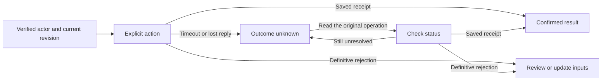

# Web workflow state inventory

Reviewed on 2026-11-19 against the 27 Next.js pages and five route handlers in
`apps/web/app`, the 37 `/v1` route group registrations and health routes in
`services/api/src/app.ts`, and all 14 launcher roles in `workers/run.mjs`.
The tables group product workflows whose state affects a user action, data
ownership or a retry. Multiple machines can govern one screen. Identity,
authorization, revision, request receipts, expiry, leases and provider dispatch
can all affect which transitions are valid. Hosted verification is linked
where available.
Mobile and Stripe activation are deferred by the product owner.

## Design decision

Keep each durable workflow in its owning database or service. Use the existing
route and component patterns to model the browser states at that boundary. Make
transitions explicit where actions need a guard, a durable result, or recovery
after a lost reply.

- **UX** Show whether the result is confirmed, rejected, stale or still unknown.
  For an unknown outcome, offer a status check. Show an empty result only after
  a successful read for the current account and resource.
- **DX** Preserve existing API and database contracts. Bind writes to the actor,
  resource and revision that authorized them. Add durable request identity for
  writes that can be duplicated or reversed by a retry.
- **AX** Put the transition owner, read-only recovery path and exact regression
  tests beside each workflow. Record which checks used fixtures, native services,
  or the hosted environment so agents can act on the right evidence.

A confirmed result and a failed follow-up refresh can coexist. An actor or
resource change invalidates the view, including any late response for the
previous scope. Only a durable receipt or a read of authoritative state can
resolve a write whose reply was lost.

## Web entry points

| Surface | Pages and route handlers |
| --- | --- |
| Landing, account and entry | `apps/web/app/page.tsx`, `apps/web/app/login/page.tsx`, `apps/web/app/signup/page.tsx`, `apps/web/app/forgot-password/page.tsx`, `apps/web/app/settings/password/page.tsx`, `apps/web/app/settings/data-rights/page.tsx`, `apps/web/app/auth/callback/route.ts`, `apps/web/app/api/auth/[action]/route.ts`, `apps/web/app/api/auth/session/route.ts` |
| Author workspace | `apps/web/app/dashboard/page.tsx`, `apps/web/app/assets/page.tsx`, `apps/web/app/books/new/page.tsx`, `apps/web/app/books/[bookId]/page.tsx`, `apps/web/app/books/[bookId]/overview/page.tsx`, `apps/web/app/books/[bookId]/memory/page.tsx`, `apps/web/app/books/[bookId]/plan/page.tsx`, `apps/web/app/books/[bookId]/ai/page.tsx`, `apps/web/app/settings/ai/page.tsx` |
| Production and sales | `apps/web/app/books/[bookId]/publish/page.tsx`, `apps/web/app/books/[bookId]/translate/page.tsx`, `apps/web/app/analytics/page.tsx`, `apps/web/app/billing/page.tsx`, `apps/web/app/api/private-audio/[actor]/segments/[projectId]/[index]/route.ts` |
| Collaboration and operations | `apps/web/app/team/page.tsx`, `apps/web/app/team/accept/page.tsx`, `apps/web/app/tasks/page.tsx`, `apps/web/app/approvals/page.tsx`, `apps/web/app/community/page.tsx`, `apps/web/app/community/[id]/page.tsx`, `apps/web/app/referrals/page.tsx`, `apps/web/app/admin/page.tsx`, `apps/web/app/api/backend/[...path]/route.ts` |

## Browser and API boundary machines

| Workflow | State and transitions to examine | Source anchors |
| --- | --- | --- |
| Public and shell navigation | Responsive menu closed or open. Selection, dismissal and Escape close it. The author shell also changes its displayed links and pending navigation when the session or workspace changes. | `apps/web/components/Header.tsx`, `apps/web/components/AuthorShell.tsx` |
| Sign-in, signup and account changes | Session unverified, verified actor, signed out or changed. Signup can await email confirmation. Callback success or error and an in-flight action each belong to their original account context. | `apps/web/components/AuthCard.tsx`, `apps/web/lib/browser-session.ts`, `apps/web/app/auth/callback/route.ts`, `apps/web/app/api/backend/[...path]/route.ts` |
| Password recovery | Reset requested, email link exchanged or invalid, session verified, update pending or completed. Sending a link and changing the password are separate actions. | `apps/web/app/forgot-password/page.tsx`, `apps/web/app/settings/password/page.tsx`, `apps/web/app/api/auth/[action]/route.ts`, `apps/web/tests/auth.test.ts` |
| Workspace onboarding and navigation | Profile provisioned by auth, then workspace selection, loading, verified, stale or unavailable. Creating a new workspace commits the organization and both owner memberships together. Changing actor or workspace invalidates dependent screens. | `apps/web/components/AuthorDashboard.tsx`, `apps/web/components/AuthorShell.tsx`, `services/api/src/routes/workspaces.ts`, `supabase/migrations/20260831023000_workspace_onboarding.sql`, `tests/security/onboarding.test.sql` |
| Dashboard and book overview | Snapshot loading, verified for this viewer, failed or invalidated on navigation or account change. The workspace and per-book views summarize distinct authoritative jobs, document versions and exports. | `services/api/src/routes/dashboard.ts`, `services/api/src/routes/book-overview.ts`, `apps/web/components/BookOverview.tsx`, `apps/web/tests/book-overview-mounted.mjs` |
| Book settings and workspace folders | A new book starts as a draft. Book edits save against the observed update timestamp or conflict. Folders can be created, renamed or moved within their workspace. Template seeding can be partially applied if a later insert fails. | `services/api/src/routes/books.ts`, `services/api/src/routes/folders.ts`, `supabase/migrations/0002_core.sql` |
| Book setup and manuscript intake | Book setup, upload allocation, quarantine/scan, import, starter content and its quote are separate; a completed upload is not a completed import. | `apps/web/components/BookSetupClient.tsx`, `services/api/src/routes/assets.ts`, `services/api/src/lib/manuscript-import.ts` |
| Manuscript editing and recovery | Saved base, dirty draft, save pending, confirmed/conflict/unknown; opt-in tab recovery is distinct from a server save. Chapter create, title, reorder and restore each have separate operations. | `apps/web/components/BookEditorClient.tsx`, `apps/web/components/ChapterTitleEditor.tsx`, `services/api/src/routes/chapters.ts`, `tests/security/chapter-creation.test.sql`, `tests/security/chapter-title.test.sql` |
| Chapter version restore | Confirmation, request in flight, outcome unknown, saved and current, or saved and superseded. Check restore status reads the existing version by actor, chapter, target, expected revision and operation. An absent receipt leaves the outcome unknown. A superseded restore keeps the draft and prompts review. | `apps/web/components/BookEditorClient.tsx`, `services/api/src/routes/chapters.ts`, `services/api/src/manual-chapter-save.test.ts`, `apps/web/tests/editor-numbering-mounted.mjs`, `tests/e2e/native-author-files.mjs` |
| Manual Book Bible and source search | Draft, saved/conflicting/unknown mutation, deleted/closed receipt; selected source and read result are bound to book and source version. | `apps/web/components/BookMemoryClient.tsx`, `apps/web/components/BookSearchPanel.tsx`, `services/api/src/routes/book-memory.ts`, `tests/security/manual-book-bible-recovery.test.sql` |
| Asset upload, versions and review | Selected, allocated, uploaded, scanned/quarantined, versioned, reviewed/approved; removal and restore are separate actor/revision-bound operations with uncertain/closed outcomes. | `apps/web/components/AssetBrowser.tsx`, `apps/web/components/RemovedAssets.tsx`, `services/api/src/routes/assets.ts`, `services/api/src/routes/asset-lifecycle.ts`, `tests/security/asset-lifecycle-additive.test.sql` |
| Saved edition and print proof | Edition draft, dirty, saved, conflict or uncertain create. A render can be absent, accepted, waiting, complete, failed or closed. Proof history and private-link expiry are distinct. Dirty settings invalidate an in-flight history read. | `apps/web/components/PublishingStudio.tsx`, `apps/web/components/SavedPrintLibrary.tsx`, `apps/web/components/SavedPdfProof.tsx`, `services/api/src/routes/render-requests.ts`, `services/api/src/routes/saved-print.ts`, `apps/web/tests/saved-print-mounted.mjs` |
| Cover artwork, QR and proof | Artwork version chosen, review pending, approved for that exact version, or superseded. QR on/off and validation belong to the edition settings. A saved edition and a generated cover proof have distinct versions. | `apps/web/components/PublishingStudio.tsx`, `apps/web/lib/publishing-edition-form.ts`, `services/api/src/routes/collab.ts`, `services/api/src/routes/editions.ts`, `services/api/src/cover-artifacts.test.ts` |
| EPUB, retailer package and downloads | A saved artifact, verified private link, expired link, preflight, export request and manual retailer handoff have different lifetimes. A saved preflight can report errors. Packaging requires a current eligible proof and a preflight with zero errors. Loading or renewing a link reads the existing output. | `apps/web/components/SavedEpubReader.tsx`, `apps/web/components/RetailerPackageRequest.tsx`, `apps/web/components/PrivateArtifactDownload.tsx`, `services/api/src/routes/reader.ts`, `services/api/src/routes/publishing.ts` |
| Retailer submission status | An author can record the status seen in a retailer account for a completed package. The server saves against the last-read revision. A stale or unconfirmed save requires a fresh read before another edit. | `apps/web/components/RetailerSubmission.tsx`, `services/api/src/routes/publishing.ts`, `tests/security/retailer-submissions.test.sql` |
| AI writer and images | Inputs, count or quote, explicit acceptance, dispatch, recovery, review and apply. Writer suggestions bind to a chapter revision. An image job can have a held, unsettled result. | `apps/web/components/AiAssistantPanel.tsx`, `apps/web/components/ImageQuoteStudio.tsx`, `services/api/src/routes/ai.ts`, `services/api/src/routes/ai-review-quotes.ts`, `services/api/src/routes/image-quotes.ts` |
| Metadata and Book Bible candidates | Counted input, funded quote, generated candidate, saved or unavailable result, review, and explicit save to metadata or canon. The legacy endpoints preserve receipt recovery while production creation requires a funded quote. | `services/api/src/routes/metadata-generation.ts`, `services/api/src/routes/metadata-quotes.ts`, `services/api/src/routes/book-bible-generation.ts`, `services/api/src/routes/book-bible-quotes.ts` |
| Story Blueprint editorial plan | Draft, saved revision, conflict and materialized chapters. Proposal generation has its own quote and approval. Opening the saved plan loads the brief for review and leaves paid execution to a separate action. | `apps/web/components/StoryBlueprintClient.tsx`, `apps/web/components/StoryBlueprintProposalPanel.tsx`, `services/api/src/routes/story-blueprints.ts`, `services/api/src/routes/story-blueprint-proposals.ts` |
| Translation and narration | Quote, explicit acceptance, generation, saved output, review and export are separate. Audio segments, QC and link expiry add more states. | `apps/web/components/TranslationStudio.tsx`, `apps/web/components/NarrationQuoteStudio.tsx`, `apps/web/components/ChapterAudioDownload.tsx`, `services/api/src/routes/translations.ts`, `services/api/src/routes/audiobooks.ts`, `services/api/src/routes/narration-quotes.ts` |
| Private playback and download | The current account must still have access when a private resource is opened. Audio distinguishes complete and validated byte-range responses, unsatisfiable ranges and unavailable access. Other artifact links can expire and be renewed via a read. | `apps/web/lib/private-audio-proxy.ts`, `apps/web/lib/private-download.ts`, `apps/web/components/PrivateArtifactDownload.tsx` |
| BYO AI connection | Credential saved/revoked, option selected, prepared/confirmed/closed and job/receipt states; customer execution remains disabled pending its separate readiness gates. | `apps/web/components/AiConnections.tsx`, `apps/web/components/CustomerAiStudio.tsx`, `services/api/src/routes/ai-connections.ts`, `services/api/src/routes/customer-ai.ts` |
| Team roster and invitations | Membership and role changes are separate from pending, expired, revoked and accepted invitation links. Read or accept under the intended account and recheck workspace access. | `apps/web/components/TeamTable.tsx`, `apps/web/components/InvitationAcceptance.tsx`, `services/api/src/routes/team.ts` |
| Community membership and referrals | Read and join, referral entry and claim, reward and credit ledger each need actor-bound visibility. Unknown outcomes have limited same-tab recovery. | `apps/web/components/CommunityDirectory.tsx`, `apps/web/components/ReferralCenter.tsx`, `services/api/src/routes/community.ts`, `services/api/src/routes/referrals.ts` |
| Community discussion and moderation | A verified account owns the discussion view and drafts. Revalidation hides posts, replies and the moderation queue. Reactions toggle active or inactive. Reports can move from open to actioned or dismissed. A confirmed write can finish across a same-account refresh. An account change discards the prior view, draft and review. | `apps/web/app/community/[id]/page.tsx`, `services/api/src/routes/community.ts`, `apps/web/tests/community-discussion-mounted.mjs` |
| Book comments, tasks and approvals | Open/resolved comments, flexible task status edits, and approval decisions each have their own rules. Repeating the legacy comment toggle can reverse a prior result. Artwork approval also requires the exact asset version. | `apps/web/components/CommentThread.tsx`, `apps/web/components/CollaborationCenter.tsx`, `services/api/src/routes/collab.ts`, `services/api/src/step9.test.ts` |
| Account requests and support | Data requests move between submitted, processing, completed, rejected and cancelled as allowed by the API or operator. A same-tab marker records an uncertain request without keeping its contents. Support tickets have open, pending, resolved and closed states. | `apps/web/app/settings/data-rights/page.tsx`, `apps/web/components/AccountMenu.tsx`, `services/api/src/routes/account.ts`, `tests/security/data-rights-confirmation-rpc.test.sql` |
| Operator access and actions | Verified administrator, denied, or stale view. Moderation, job retry or hold settlement, user suspension and feature flag changes have distinct access checks and outcomes. | `apps/web/components/AdminConsole.tsx`, `services/api/src/routes/admin.ts`, `services/api/src/plugins/admin.ts`, `tests/security/admin-flags.test.sql` |
| Analytics and billing views | Workspace/actor selection, loading/error, imported report state and credit ledger/plan access; manual report data is not live retailer connectivity. Stripe activation remains deferred. | `apps/web/app/analytics/page.tsx`, `apps/web/components/BillingCenter.tsx`, `services/api/src/routes/sales.ts`, `services/api/src/routes/billing.ts` |

## Durable and worker state machines

| Area | Authoritative concepts and source anchors | Test navigation (existence only; not a fresh pass) |
| --- | --- | --- |
| Membership and invitations | Membership invited/active/suspended, invitation pending/accepted/revoked/expired; role and expiry are separate. `supabase/migrations/0002_core.sql`, `supabase/migrations/20260904120000_collaboration_invitations.sql` | `tests/security/collaboration-invitations.test.sql` |
| Import and authoring receipts | Import queued/running/succeeded/failed also binds attempts, lease, checksum and document receipt. Title/create/restore receipts close or conflict independently. `supabase/migrations/20260910100000_manuscript_import_jobs.sql` | `tests/security/chapter-creation.test.sql`, `tests/security/chapter-restore-ledger.test.sql` |
| Asset lifecycle | Scan, version and review plus soft deletion are separate; staged operation receipts bind actor, action and revision. `supabase/migrations/20260907110000_asset_quarantine.sql`, `supabase/migrations/20261103011721_asset_lifecycle_additive.sql` | `tests/security/asset-quarantine.test.sql`, `tests/security/asset-lifecycle-cutover-native.mjs` |
| Quotes, credits and AI jobs | Quote and credit hold/settlement/review/cancellation, provider dispatch, job lease and output review are not interchangeable. Later migrations add transitions; inspect the latest function. `supabase/migrations/20260919100000_funded_usage_quotes.sql`, `supabase/migrations/20260919140000_cancel_undispatched_translation.sql` | `tests/security/narration-funded-lifecycle.mjs`, `tests/security/translation-quote-requests.test.sql` |
| Suggestion review and apply | The job outcome and suggestion state are independent. Applying a pending suggestion uses the expected document version, writes the next version and records the decision. A rejected suggestion remains distinct from a failed job. `services/api/src/routes/ai.ts`, `supabase/migrations/0004_ai.sql` | `tests/security/manual-chapter-save.test.sql`, `tests/e2e/native-author-files.mjs` |
| Story planning | Blueprint proposal and quote progress are distinct from materializing chapters and paid draft execution. `supabase/migrations/20260919200000_story_blueprint_quote_proposals.sql` | `services/api/src/routes/story-blueprint-proposals.ts`, `services/api/src/lib/quoted-story-blueprint-worker.ts` |
| Derived search index | Chunk preparation and a persisted embedding receipt precede paid index writes. An index retry reuses the prepared receipt. Search scopes candidates to the current tenant, model and source versions and verifies returned evidence. `services/ai/rag/indexer.py`, `services/ai/rag/qdrant_client.py` | `services/ai/tests/test_semantic_index_local.py` |
| Narration and translation | Project/job, leased processing, segment assets, QC/signoff, quote settlement and archive export are separate. `supabase/migrations/20260912160000_audiobook_workflow.sql`, `supabase/migrations/20260912180000_translation_workflow.sql` | `tests/security/native-narration-lifecycle.mjs`, `tests/integration/test_google_play_cover_transport.py` |
| Rendering and publishing | Render, preflight, package, worker lease and request closure each have distinct identities; closure must fence an unaccepted request. `supabase/migrations/20260903120000_render_workflow.sql`, `supabase/migrations/20260905120000_publishing_worker_leases.sql`, `supabase/migrations/20261104110000_render_close_request.sql` | `tests/security/render-workflow.test.sql`, `tests/security/native-render-close.mjs`, `tests/security/publishing-worker.test.sql` |
| Render proof eligibility | Saved files can be available, superseded, removed or unverified for packaging. The API checks canonical v1, the verdict and byte integrity. The completion transaction holds the proof's metadata through the package, usage and activity writes. For an uncertain completion the status read retains the original request identity. `services/api/src/routes/publishing.ts`, `services/api/src/lib/publishing-worker.ts`, `supabase/migrations/20261118194054_publishing_render_proof_completion.sql` | `services/api/src/rendering-api.test.ts`, `tests/security/publishing-package-workflow.test.sql`, `tests/security/google-play-ebook-export.test.sql`, `tests/security/native-artwork-completion.mjs` |
| Retailer status records | A completed export owns one workspace-visible, author-reported status. Revision checks serialize edits, and removing a package file preserves the report. `supabase/migrations/20261118013037_retailer_submissions.sql` | `tests/security/retailer-submissions.test.sql`, `tests/e2e/native-author-files-packages.mjs`, `apps/web/tests/saved-print-mounted.mjs` |
| Sales imports | An imported report can be current or superseded; digest and replacement identify the report. It is not live retailer sales integration. `supabase/migrations/20260912190000_retailer_sales_imports.sql` | `tests/security/retailer-sales-imports.test.sql` |
| Customer-owned AI | Connection revision/revocation, preparation, authority, dispatch, leased job, receipt and maintenance journal form separate machines. `supabase/migrations/20261024020000_ai_connection_vault.sql`, `supabase/migrations/20261024070000_customer_ai_preparations.sql`, `supabase/migrations/20261028070000_customer_ai_maintenance_journal.sql` | `tests/security/customer-ai-preparations.test.sql`, `tests/security/customer-ai-jobs.test.sql`, `tests/security/customer-ai-maintenance-journal.test.sql` |
| Referrals, credits and operations | Referral attribution/review/reward and immutable ledger entries differ from support, moderation and data-rights request states. `supabase/migrations/20260905070000_referral_transactions.sql`, `supabase/migrations/0012_community_extras.sql`, `supabase/migrations/0013_admin_ops.sql` | `tests/security/referral-transactions.test.sql`, `services/api/src/routes/admin.ts` |
| Plan and payment intake | Entitlements derive from the current subscription and its period. Stripe source has availability, mapped checkout and portal, signed webhook claim, duplicate or busy, and settled event states. Activation is deferred. `services/api/src/lib/entitlements.ts`, `services/api/src/routes/billing.ts`, `supabase/migrations/20260912150000_plan_publication_controls.sql` | `tests/security/plan-publication.test.sql`, `tests/security/stripe-webhook-transactions.test.sql` |
| Request deduplication | Generic POST idempotency stores seen actor/route/key combinations in one API process and expires them. Routes marked for durable idempotency put replay and receipt handling with the workflow owner. `services/api/src/plugins/idempotency.ts`, `services/api/src/routes/book-memory.ts` | `tests/security/manual-book-bible-recovery.test.sql`, `tests/security/chapter-creation.test.sql` |
| API readiness and worker supervision | API liveness, dependency readiness and active queue consumption have different signals. The local document worker starts after extraction and scanning are available, backs off on child exits, and stops if a required private service becomes unavailable. `services/api/src/routes/health.ts`, `scripts/run-local-processing.mjs`, `scripts/run-local-import-worker.mjs`, `docs/WORKER_RUNTIME.md` | `services/api/src/redis-readiness.test.ts`, `docs/WORKER_RUNTIME.md` |

## Verified gaps and review limits

- A pending saved-print history request invalidated by unsaved edition settings
  could be mistaken for an empty archive. The fix marks history for
  refresh when settings become clean and explains why checking is paused while
  dirty; see the mounted regression tests. Confirm the exact commit and suite
  result in Git before relying on it.
- The existing `POST /comments/:id/resolve` is a toggle. An isolated invocation
  of the current handler showed two identical requests resolve and then reopen a
  comment. The toggle is an SDK/API contract. The web editor does not mount
  the standalone comment thread. A desired-state prototype alone still permits a
  delayed earlier request to reverse a later action. Durable operation identity,
  revision fencing and old/direct-writer coordination need further design.
- Mounted synthetic tests reproduced referral and invitation account-switch
  races. The invitation fix binds the request to the verified actor,
  rechecks the session and keeps an unconfirmed result separate from success;
  its warning remains tab-memory only and the existing backend does not provide
  a durable accepted-invitation receipt. Referral reads and claims now bind to
  the verified actor; an uncertain claim retains the original code for an
  explicit retry in the same tab. This does not coordinate different tabs, and
  hosted uniqueness has not been verified. Community discovery and join now
  bind to a verified actor and hide prior results during revalidation. Its
  locally remembered Joined state is not refreshed after external membership
  revocation, and uncertain joins are not persisted across remounts or tabs.
  These tests do not establish hosted authentication or data behavior.
- Chapters and editions originally have text status columns; edition API
  validation is not proof that every direct database writer enforces the same
  transitions. Inspect later migrations and live ACLs before adding constraints.
- Hosted render closure and retailer status are installed. [The rollout evidence](evidence/supabase-publishing-rollout-2026-11-18.json)
  records the migration and access checks. Signed-in hosted UI acceptance is
  pending. Retailer status records what the author reports about the submission.
- Saved EPUB proofs can be selected for packaging after reopening Publishing
  Studio. Retailer preflight checks the stored EPUB and cover through the
  private publishing service. It requires the saved render to match the
  current manuscript, edition settings and artwork. The preflight receipt
  binds the selected render ID and EPUB checksum to the new package. Saved
  EPUB and cover version eligibility is checked before reading either file. Older
  proofs remain available for reading and download. Render and package jobs
  keep their existing storage and entitlement checks. See
  `services/api/src/rendering-api.test.ts`, `services/publishing/tests/test_adapters.py`,
  and `tests/e2e/native-author-files-publishing.mjs`.
- Opening a saved print proof selects its PDF interior and paired cover for the
  next retailer preflight. The report records the render ID and both checksums,
  including an explicit null when there was no cover. Packaging is enabled only
  after a zero-error report for that selection. The API and worker check the
  same stored bytes and use the current approved full-bleed illustrations for
  resolution checks. Universal export keeps its existing preflight.
- All EPUB and print package requests now require a verified render and cover
  when present. If eligibility changes while packaging, the API asks the author
  to choose a current proof or render again. Migration
  `20261118194054_publishing_render_proof_completion.sql` fences concurrent
  proof changes at completion of a package or exact EPUB preflight. Migration
  `20261119172907_saved_print_preflight_binding.sql` extends the same guard to
  selected print proofs. Existing
  completed packages are recovered from their own receipts. The schema guard
  is staged with its matching API and worker changes for coordinated rollout.
- Kindle ebook packages include an RGB `cover.jpg` derived from the saved
  `cover.png` proof. The ZIP keeps the original EPUB and PNG, checksums all
  files, and names the files to upload in `README.txt`. Preflight rejects an
  unreadable or unusable supplied proof and offers the author's own cover or
  KDP Cover Creator when a cover is absent. The KDP package row links to the
  author's Bookshelf after a successful export. Rendering and publishing share
  ruleset `kdp-1.5.0` for this change.
  [KDP cover specifications](https://kdp.amazon.com/en_US/help/topic/G200645690)
- Editors can check removal history using the existing schema. The read confirms
  the file's current removed state. A lost removal reply remains unconfirmed.
  Restore is gated on verified asset-recovery readiness and uses a new,
  revision-bound operation. The local release keeps the restore gate off.
- Chapter restore status uses the saved document version and its canonical
  content, so an illustration's availability today cannot hide a previously
  saved restore. Recovery stays in the original tab. A status check does not
  cancel a pending write. The original restore write and its illustration checks
  continue to apply for retries. The separate chapter restore ledger is outside
  this flow.
- A mounted discussion fixture reproduced a draft being posted under an account
  that replaced the one that opened the page. Reads and writes now use the
  verified actor in the web proxy. An account change invalidates previous drafts,
  moderation decisions and delayed results. Foreground checks hide data while
  access is revalidated. The same verified author can finish a pending save
  and keep drafts after a rejection. A confirmed moderation decision remains
  visible when the following discussion refresh fails. The browser fixture
  exercises the real API client against a synthetic boundary. Hosted account behavior and durable
  recovery after a lost write response are separate checks.
- Generic POST deduplication marks a key before the handler responds. A duplicate
  error confirms the key was seen in that process. Recovering the original result
  requires a workflow receipt or a fresh read.

## Maintaining a workflow

1. List the durable owner, browser-only state and every authorized transition.
   Include the actor, resource and revision or request identity needed to
   distinguish stale work from the current operation.
2. Trace success, definitive rejection and unknown outcomes separately. A
   timeout or lost reply does not establish that a write failed. Specify what
   survives a reload, which retries are safe and how the user can recover.
3. Test late success and failure, account/workspace changes, duplicate actions,
   access revocation, concurrent writes and unmount or remount when relevant.
   Include a real boundary test when mocks cannot establish the property.
4. Update this index and the shared handoff when ownership, transitions or
   rollout gates change. Point to exact tests and distinguish local fixtures
   from hosted acceptance. Keep credentials and user data out of both.
